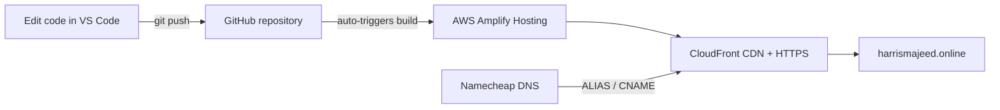

# AWS-CV: My Online CV, Hosted on AWS

A personal CV website, deployed to the cloud with a custom domain, HTTPS and automatic deployments from GitHub.

**Live site:** [harrismajeed.online](https://harrismajeed.online)

I built this project to get hands-on experience with cloud hosting, DNS and CI/CD, while also giving myself a professional place online to share my CV. Rather than using a ready-made website builder, I set up the whole pipeline myself: writing the site, version-controlling it, deploying it on AWS and connecting my own domain.

## Tech stack

| Area | Tools |
|---|---|
| Front end | HTML5, CSS3 |
| Version control | Git, GitHub |
| Hosting and CI/CD | AWS Amplify Hosting |
| Content delivery and HTTPS | Amazon CloudFront, AWS Certificate Manager (managed by Amplify) |
| Domain and DNS | Namecheap (registrar and DNS), CNAME and ALIAS records |
| Editor | Visual Studio Code |

## How it works



## How I built it

### 1. Writing the CV and setting up GitHub
I started by setting up my GitHub repository and connecting it to VS Code. I then spent time writing and designing the CV itself. Once I was happy with it, I pushed the code to GitHub.

### 2. Deploying the CV to AWS Amplify
With the code written and synced to GitHub, the next step was getting it live. I created an AWS account, opened the main dashboard and found **AWS Amplify**. I deployed a new app, chose my GitHub repository and selected the `main` branch. I named the app **Online-cv** and continued through the setup.

Because the app is connected to GitHub, every push to `main` now triggers a new deployment automatically, with no manual uploads.


### 3. Buying a custom domain
I then bought a custom domain name and added it to the website. I had to buy the domain from **Namecheap** rather than through AWS, because AWS doesn't allow domain registration on a Free Plan account.


### 4. Connecting the domain to Amplify
Since the domain is registered outside AWS, I configured the DNS records manually at Namecheap, using the values Amplify gave me:

- a **CNAME** record for SSL certificate validation
- an **ALIAS** record for the root domain
- a **CNAME** record for `www`

I used the Amplify-managed SSL certificate, so the site is served over HTTPS and the certificate renews automatically.

## Problems I ran into and how I solved them

| Problem | Cause | Fix |
|---|---|---|
| `git push` was rejected | The GitHub repo already contained a README, so the histories had diverged | Pulled with `--allow-unrelated-histories`, completed the merge, then pushed |
| Amplify showed a "Welcome" placeholder instead of my site | The build settings pointed at an output directory that doesn't exist in a plain HTML project | Edited the build specification so `baseDirectory` is `/` |
| Couldn't register a domain through AWS (`AccessDeniedException`) | Free Plan accounts can't register domains | Bought the domain from Namecheap and configured the DNS records manually |
| Domain verification can stall if records are entered wrongly | Registrars automatically append the domain to record names, which can double it | Entered only the host portion of each record, since the registrar adds the rest |

## What I learned

- How a Git workflow ties into automated deployments
- How DNS works in practice: CNAME vs ALIAS records, certificate validation records, and why the root domain needs special handling
- How HTTPS certificates are issued and validated
- How the AWS Free Plan, credits and expiry work, and how to avoid surprise charges
- Debugging deployment problems by reading build output and error messages

## Running it locally

```bash
git clone https://github.com/HarrisMajeed07/AWS-CV.git
cd AWS-CV
```

Then open `index.html` in a browser, or use the VS Code **Live Server** extension.

## Project structure

```
AWS-CV/
├── index.html    # Page content
├── styles.css    # Styling
└── README.md     # You are here
```

## Contact

**Harris Majeed**, Computer Science student, England
GitHub: [@HarrisMajeed07](https://github.com/HarrisMajeed07)

<!-- Add your LinkedIn and email here, for example:
LinkedIn: [your-name](https://www.linkedin.com/in/your-profile)
Email: you@example.com
-->
